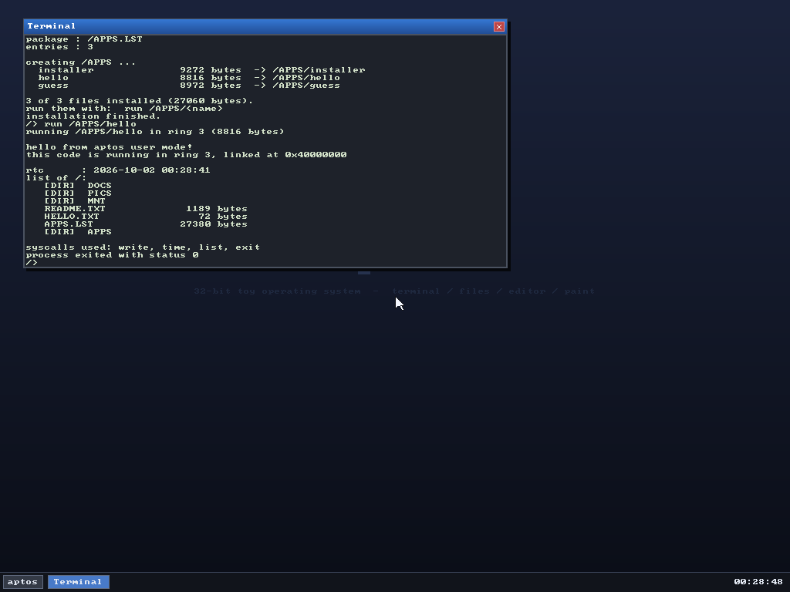

# aptos —— 一个能跑起来的 32 位小操作系统

用 C 写的玩具操作系统：自带两段式引导程序、VBE 图形界面、窗口管理器、PS/2 键鼠驱动、
块设备层（多硬盘 / 软盘 / ATAPI CD-ROM）、VFS 挂载、自制**层级文件系统**、
ACPI、**ring 3 用户态 + 系统调用 + ELF 加载器**，以及一个能自我安装的
**可引导安装光盘**（El Torito）。
全部代码约 13437 行（不含注释），`make` 一条命令出镜像，`make test` 无人值守跑一遍并截图。



*终端里 `paint` 打开画板、鼠标手绘、任务栏多窗口切换——全部截图都是 QEMU 里真实跑出来的画面。*

---

> **只想用、不想看代码？** 看 [MANUAL.md](MANUAL.md)（用户手册：快速上手、
> 终端命令参考、桌面操作规范、安装向导、常见问题）。

## 1. 快速开始

```bash
make            # 生成 build/os.img（64 MiB）
make mini       # 生成 build/os-mini.img（8 MiB，功能完全一样，MINI_MB= 可调）
make floppy     # 生成 build/floppy.img（1.44 MiB 数据软盘，纯 MINIFS）
make apps       # 编译 apps/*.c 并打成 build/apps.lst（打进 os.img 根目录）
                # 同时把五个应用预装到镜像的 /APPS/ 下，开机就在桌面上
make run        # 用 QEMU 带窗口启动（需要图形环境）
make test       # 无头启动 + 模拟敲键盘 + 截图到 build/screen.png
make iso        # 生成 build/aptos-install.iso（可引导的安装光盘，1.7 MiB）
make clean
```

### 安装光盘（ISO）

`make iso` 产出 **`build/aptos-install.iso`**，用 QEMU 直接挂光驱就能装系统：

```bash
qemu-system-i386 -m 128 -vga std -cdrom aptos-install.iso \
  -drive file=disk.img,format=raw,index=0,media=disk
```

光盘里放着四样东西：

| 位置 | 内容 |
|---|---|
| El Torito 引导镜像 | `build/boot.img`（1.44 MiB，软盘模拟）——stage1 + stage2 + 内核 |
| `/KERNEL.ELF` | 内核（图省事就叫这个名字，实际是平坦二进制） |
| `/SETUP.LST` | 安装程序包（`.lst` 格式，里面是一个 ring 3 的 `setup` 应用） |
| `/SYSTEM.ERT` | **整个系统的压缩快照**（引导镜像 + 全部文件与目录结构） |

引导链：SeaBIOS 按 El Torito 目录把 `boot.img` 当**软盘**模拟 → stage1 读 stage2 →
stage2 读内核 → 内核发现 `boot_drive < 0x80`（不是硬盘）→ 挂载 cd0 到 `/` →
自动跑 `/SETUP.LST`。

> 踩坑记录：SeaBIOS 对 El Torito 的软盘/硬盘模拟**都不提供 INT 13h AH=42h（LBA 读）**，
> 只给 AH=02h（CHS）。所以两段引导器都改成"先试 LBA，失败就按 1.44 MiB 软盘几何
> （18 扇区/道、2 磁头）逐扇区 CHS 读"。

**安装界面是 Windows 风格的向导**（`apps/setup.c`，纯 ring 3 + 图形系统调用画出来的）：

| 页 | 内容 | 按钮 |
|---|---|---|
| 1 | Welcome：说明装什么、装到哪 | `Cancel` `Next >` |
| 2 | 选目标盘：列出所有 IDE 硬盘（名称 / 容量 / 类型），**放不下的盘标红 `too small` 并禁用 Install**，并给出所需最小容量 | `< Back` `Install` |
| 3 | 安装中：进度条（0–100%）+ 当前正在写的文件名和字节数 | `Working...` |
| 4 | 完成：绿勾 + "Setup completed successfully."，提示拔盘重启 | `Finish`（走 8042 复位重启） |

装不下的盘会被提前拦住：最小容量 = 系统镜像占用 + 1 MiB 文件系统空间
（当前约 **1114 KiB**）。错误码不再被吞掉，而是原样透传并翻译成人话：

| 码 | 含义 |
|---|---|
| -1 | 设备不是 512 字节扇区（选到了光驱之类） |
| -2 | 文件系统起始扇区 >= 盘总扇区（盘比系统镜像还小） |
| -3 | 格式化失败（盘太小，建不出最小文件系统） |
| -4 | 挂载表满 |
| -5 | 建完后回读失败（读位图/超级块出错） |

**文件系统尺寸封顶 256 MiB**：装 127 KiB 的文件没必要去逐扇区抹 8 GiB 的盘。
更大的盘只把前 256 MiB 划给系统，格式化瞬间完成（日志里会标 `capped`）。

安装是**状态机**：主循环每帧只做一步（解压引导镜像 / 裸写引导扇区 / 建文件系统 /
写一个文件），所以进度条是真的在动、界面全程不卡。键盘也能用：`Enter` = 默认按钮，
`ESC` = 返回/退出。

安装程序做的事：

1. `sys_bootmode()` 判断启动盘：`>= 0x80` 是硬盘 → 走**彩蛋**；否则走安装。
2. 读 `/SYSTEM.ERT`，LZSS 解压出引导镜像（90 KiB）→ `sys_rawwrite("hd0", 0, ...)`
   整块写进 LBA 0（**必须裸写**：stage1/stage2/内核是引导器按固定 LBA 找的，不能当文件放）。
3. `sys_install("hd0", 177)` → 在 LBA 177 建 MINIFS02 并挂到 `/TARGET`。
4. 按快照里的条目逐个 `sys_mkdir` / `sys_open`+`sys_write`，把 `/APPS`、`/DOCS`、
   `/DOCS/GUIDE`、`README.TXT`、五个 `*.APP`、`APPS.LST`、`SETUP.LST` 全部写进去。
5. 打印 `Installation complete. Remove the CD-ROM and reboot.`

**内存支持**：恒等映射按 E820 实际内存来（上限 3 GiB），用户空间固定在
`0xC0000000`——**放在恒等映射永远够不到的地方**。这一点很关键：早先把用户窗口放在
`0x40000000`，机器内存 ≥ 1 GiB 时恒等映射会一直盖到那里，恒等映射建的 PDE 是内核
专用的，于是用户程序一取指就 #PF。现在 8 MiB 到 2048 MiB 都能装（实测）。

**彩蛋**：如果在**已经装好系统的硬盘**上运行这个安装程序（`install /SETUP.LST`），
它会全屏画一张愤怒的大脸，红字打出
`How dare you install a system on the hard disk.` + `Bold!`，
等 10 秒（1000 ticks，循环里 `hlt` 挂起、时钟中断照常响应），然后走 ACPI S5 直接把机器关掉。

`SYSTEM.ERT` 的格式（`tools/mkert.py` 打包）：

```
0x00  "ERT1"        u32 版本
0x08  u32 引导镜像原始大小    0x0C u32 压缩后大小
0x10  u32 条目数              0x14 u32 保留
0x18  [压缩的引导镜像]
      条目（重复 N 次）：
        u8  类型（0=文件 1=目录）
        u8  保留
        u16 名字长度
        u32 原始大小
        u32 压缩后大小
        char 名字[名字长度]      （不含前导斜杠）
        u8  数据[压缩后大小]
```

压缩是自制的 **LZSS**（4 KiB 窗口、最短匹配 3、最长 18），`tools/mkert.py` 里是
Python 压缩器，`apps/setup.c` 里是 C 解压器。整个快照 198 KiB → 111 KiB。
打包时会**当场解压回来逐个字节比对**，不一致就直接报错退出。

### 在老模拟器 / 手机上跑（Limbo 等）

`aptos` 刻意只要求 **i386 指令集**，可以在 Limbo PC Emulator、Bochs、
老版本 QEMU、VirtualBox 这类环境里跑。为此做了三件事：

* **按 `-march=i386` 编译**（内核和 apps 都是）。默认的 i686 代码生成会插入
  `cmov` 之类的 Pentium Pro 指令，486 一执行就是 #UD；因为第一条 cmov 可能出现在
  IDT 装好之前，表现出来是**三重故障、屏幕停在一行字上死掉**，非常难查。
* **不用 4 MiB 大页**。大页要开 `CR4.PSE`，老 CPU 上会 #GP。现在全部用 4 KiB 页做
  恒等映射，映射范围按 E820 实际内存算（16..256 MiB）。
* **帧缓冲地址不写死**。老 QEMU / Limbo 的 Bochs VBE 线性帧缓冲在 `0xE0000000`，
  新 QEMU 在 `0xFD000000`。现在按 `BOOTINFO->fb_addr` 现场映射。

另外 IDT 现在**在开分页之前**就装好了：万一哪块内存没映射上，会打印
`[panic] exception 14: page fault` 而不是静默重启。图形控制台起来之前，内核日志
还会同时写一份到 `0xB8000` 的 VGA 文本缓冲区——如果 VBE 没成功、机器还停在文本
模式，你就能直接在屏幕上看到内核日志。

Limbo 里建议设置：CPU **486 或 Pentium**、内存 **≥ 32 MiB**、显卡 **std / Bochs VBE**、
硬盘选 `os.img`（类型 raw / hd）。

### 依赖

| 需要 | 说明 |
|---|---|
| `nasm` | 汇编引导扇区和中断桩 |
| `i686-linux-gnu-gcc`（或 `gcc-multilib`） | 交叉编译内核，`-m32` |
| `python3` | 生成镜像、跑无头测试 |
| `qemu-system-i386` | 运行（`-vga std` 才有 VBE） |

Makefile 会自动找 `i686-linux-gnu-` 前缀，找不到就回退到本机 `tools/env.sh` 里那套
解包在 `/opt/tc` 的工具链（本项目的开发环境就是这么装的：没有 root，用
`apt-get download` + `dpkg-deb -x` 把 deb 解到本地前缀即可）。

```bash
. tools/env.sh   # 把 /opt/tc 的工具链和 QEMU 加进 PATH
```

---

## 2. 目录结构

```
boot/stage1.asm      MBR：加载 stage2 并跳过去（512 字节，只剩 60 字节余量）
boot/stage2.asm      E820 内存图、VBE 模式枚举、加载内核、开 A20、进保护模式
linker.ld            内核链接脚本，入口固定在 0x10000

kernel/entry.asm     保护模式入口：建栈、清 BSS、调 kmain
kernel/kmain.c       内核主流程
kernel/types.h       固定宽度类型
kernel/io.h          端口 I/O、rep movsl、rdtsc
kernel/util.c        memset/memcpy/str*/itoa/自实现 vsnprintf/64 位除法
kernel/serial.c      COM1，无头调试用
kernel/klog.c        内核日志环形缓冲，兼作 dmesg 数据源
kernel/console.c     启动期全屏文字控制台（GUI 起来后交棒）
kernel/heap.c        线性 bump 分配器（内核只分配不释放）
kernel/gfx.c         32 位软件后备缓冲 + 绘图原语 + 按 8/16/24/32bpp 呈现
kernel/font8x8.h     内嵌 8x8 点阵字库（公有领域）

kernel/isr.asm       48 个中断桩，统一压栈后进 isr_handler
kernel/idt.c         IDT、8259A 重映射、异常打印
kernel/timer.c       PIT 100 Hz
kernel/keyboard.c    PS/2 键盘（扫描码集 1，含 Shift/Ctrl/Caps 和历史缓冲）
kernel/mouse.c       PS/2 鼠标（IRQ12，中断里一次排空控制器缓冲）
kernel/rtc.c         CMOS 时钟
kernel/blkdev.c      块设备抽象层：注册 / 按名查找 / 读写派发
kernel/acpi.c        ACPI 表解析（RSDP/RSDT/XSDT/FADT/MADT）+ S5 关机
kernel/paging.c      分页：恒等映射 256 MiB + 用户地址空间细页映射
kernel/gdt.c         GDT（含用户段）与 TSS（ring3 → ring0 切栈）
kernel/usermode.asm  iret 进 ring3 / 退出时恢复内核栈
kernel/elf.c         ELF32 加载器（按 PT_LOAD 映射用户页）
kernel/user.c        进程生命周期：装载、进入、退出、回收
kernel/syscall.c     int 0x80 分发 + 用户文件句柄 + 包句柄 + 图形调用
kernel/uapp.c        用户态图形应用：窗口、画布、矩形/文字绘制、鼠标坐标
kernel/lst.c         .lst 安装包格式解析
kernel/pkg.c         打开包 → 取出安装程序 → 在 ring 3 里跑
kernel/ata.c         ATA PIO：双通道 4 设备（LBA28）+ ATAPI 包命令（CD-ROM）
kernel/floppy.c      软驱：FDC 765 + 8237 DMA 通道 2，1.44 MiB
kernel/iso9660.c     ISO9660 只读文件系统（CD-ROM）
kernel/fs.c          VFS：挂载表、路径路由、按文件系统派发
kernel/minifs.c      MINIFS02 实现（可多实例挂载）
kernel/fs.c          MINIFS02 层级文件系统（目录树 / 路径解析）

kernel/gui.c         窗口管理器：桌面、任务栏、开始菜单、窗口、鼠标指针
kernel/app_terminal.c  终端 + shell（约 20 条命令）
kernel/app_files.c     文件浏览器
kernel/app_editor.c    文本编辑器（打开/编辑/保存）
kernel/app_paint.c     画板
kernel/app_about.c     关于
kernel/app_snake.c     贪吃蛇
kernel/app_mines.c     扫雷
kernel/app_2048.c      2048

tools/mkimg.py       生成 os.img：写入两个引导阶段、内核，并在尾部格式化 MINIFS02
tools/lsimg.py       宿主机侧解析镜像：打印文件树、大小、时间戳
                     用法: python3 tools/lsimg.py build/os.img
tools/mkiso.py       纯 Python 生成 ISO9660 光盘镜像（测试 CD-ROM 用）
                     用法: python3 tools/mkiso.py --out build/test.iso
tools/mkcd.py        纯 Python 生成 El Torito 可引导 ISO（无需 genisoimage/xorriso）
tools/mkert.py       SYSTEM.ERT 打包器：快照整个文件系统 + LZSS 压缩 + 往返自检
apps/setup.c         安装程序（ring 3）：解压快照、写引导扇区、建 FS、写文件 + 彩蛋
apps/lib/aptos.h     应用侧 SDK：系统调用包装 + 迷你 printf/string
apps/lib/start.asm   _start：调 main，然后 sys_exit
apps/installer.c     安装程序：解包 + 把文件写进 /APPS
apps/hello.c         演示：读 RTC、列目录
apps/guess.c         演示：猜数字（阻塞读键盘，跑在 ring 3）
apps/freecell.c      空当接龙（用户态图形应用，画布 + 鼠标）
apps/spider.c        蜘蛛纸牌（单花色，104 张）
apps/lib/cards.h     扑克牌绘制（共用）
tools/qemu_test.py   无头驱动 QEMU：模拟按键/鼠标、截图、转 PNG（纯 Python）
tools/check_kernel.py 链接后检查内核有没有长进 0x9FC00 以上的遗留洞
```

---

## 3. 它是怎么跑起来的

### 3.1 启动流程

```
BIOS
 └─ 读 LBA0 到 0x7C00 执行 stage1
     └─ INT 13h AH=42h 读 LBA1..8 到 0x8000，远跳转
         └─ stage2：
             ├─ INT 15h E820 取内存图，存到 0x5200
             ├─ INT 10h 4F00/4F01/4F02 枚举 VBE 模式表，挑最合适的线性帧缓冲
             ├─ INT 13h 分块（每块 32 扇区 = 16 KiB）把内核读到 0x10000
             ├─ 开 A20（BIOS + 8042 + Fast A20 三种都试）
             ├─ 装平坦 GDT，置 CR0.PE
             └─ jmp 0x10000
                 └─ kernel/entry.asm：设段寄存器、esp、清 BSS、call kmain
```

引导程序和内核之间只通过固定物理地址 **0x5000 的 `bootinfo_t`** 传参
（帧缓冲地址/宽高/pitch/bpp、E820 表地址和条数、内核与文件系统的 LBA）。

### 3.2 内存布局

```
0x005000  bootinfo_t（引导程序填好，内核只读）
0x005200  E820 内存图（最多 40 条 × 24 字节）
0x005600  VBE 控制器信息 / 0x5900 模式信息 / 0x5C00 模式表副本
0x007C00  引导期栈（向下增长）
0x010000  内核镜像（.text + .rodata + .data）
   ...    .bss + 64 KiB 内核栈（栈顶 = _kernel_end）
0x0A0000 ─ 0x0FFFFF  VGA 显存窗口 / 视频 BIOS / EBDA —— 不是普通 RAM
0x100000  内核堆（bump 分配）：后备缓冲、位图、画布、DMA 缓冲
0xC0000000 用户程序代码/数据（4 KiB 页，U/S=1）
0xEF800000 用户栈顶（192 KiB，向下增长）
0xFD000000 VBE 线性帧缓冲（每个像素直接写这里）
```

内核被刻意限制在 **0x9FC00 以下**，`tools/check_kernel.py` 会在链接后检查
`_kernel_end`，超了就编译失败——这是踩过大坑之后的护栏（见第 7 节）。

启动后期开启分页，**内核与堆照旧直接寻址**（恒等映射）。映射范围不是写死的，
而是**按 E820 报告的实际内存算**：

```
恒等映射   0 .. mem_top   （mem_top = E820 里最高的可用地址，上限 0xC0000000）
           4 KiB 细页，不依赖 CR4.PSE，老 CPU 也能跑
帧缓冲     按 BOOTINFO->fb_addr 单独映射（新 QEMU 在 0xFD000000，老 QEMU/Limbo 在 0xE0000000）
用户空间   0xC0000000 起，4 KiB 细页，U/S=1
```

于是同一份镜像能自适应：16 MiB 的老机器映射 16 MiB，**1 GiB 的机器映射 1 GiB**
（实测 64 / 256 / 512 / 1024 / 2048 MiB 全部正常启动）。堆的上限也跟着走，
等于"整块可用内存减去 1 MiB 保留"。

代价是页表本身要花内存：1 GiB 需要 256 张页表 = **1 MiB**，相对整机内存可以忽略。

> 32 位内核最多寻址 4 GiB；这里把上限压在 `0xC0000000`（3 GiB），
> 因为再往上通常是 PCI/MMIO 空洞，不是 RAM。

### 3.3 图形

引导程序把 VBE 模式信息读进 `bootinfo`，内核 `gfx.c` 建一块 32 位软件后备缓冲：

* 所有绘制都发生在后备缓冲（普通 RAM，快）；
* `gfx_present()` 一次把整屏刷到帧缓冲；
* `gfx_present_rect()` 只刷一小块——鼠标移动只刷两个 12×19 的小矩形，
  不重绘整屏，这是这套 GUI 在纯模拟器里还能跟手的关键；
* 目标像素格式自适应 32/24/16 bpp，VBE 完全不可用时退回 VGA mode 13h（8bpp，3-3-2 调色板）。

VBE 模式是**枚举挑选**的，不是写死模式号：扫描 BIOS 返回的模式表，
只考虑 direct-colour、宽度 640–1024、高度 480–768 的模式，
按 `(bpp 等级 << 16) + 像素数/64` 打分取最高。QEMU 上稳定选到 1024×768×32。

### 3.4 中断

`isr.asm` 用 NASM 宏生成 48 个桩（0–31 异常，32–47 重映射后的 IRQ），
统一压出 `regs_t` 帧后进 C 的 `isr_handler()`。8259A 重映射到 0x20/0x28，
所有 IRQ 先屏蔽，由各驱动 `irq_unmask()` 自己打开。异常会打印寄存器并停机。

键盘和鼠标共用 0x60 数据口，两个 ISR 都在循环里**一次排空**控制器缓冲，
只取 status 位上属于自己的那一路——一字节一次的老写法会在窗口重绘时丢包，
表现为鼠标拖动“少走一截”。

### 3.5 存储：块设备 → VFS → 文件系统

三层结构，加一种新介质只要实现最下面一层：

```
应用 / shell
   ↓  fs_*（路径）
VFS（kernel/fs.c）        挂载表 + 最长前缀路径路由 + 读写权限
   ↓                        ├── MINIFS02（可读写）
文件系统实现               └── ISO9660（只读）
   ↓  blk_read / blk_write
块设备层（blkdev.c）       按名字注册：hd0..hd3 / fd0 / cd0
   ↓
驱动：ata.c（PIO+ATAPI）· floppy.c（FDC+DMA）
```

`dev` 命令能看到当前所有块设备：

```
NAME  TYPE    SECTORS      SIZE  MODEL
hd0   hdd      131072    64 MiB  QEMU HARDDISK
hd1   hdd       32768    16 MiB  QEMU HARDDISK
cd0   cdrom        27    54 KiB  QEMU DVD-ROM (ro)
fd0   floppy     2880     1 MiB  1.44M floppy
```

挂载、卸载、格式化：

```
mount hd1 /MNT/D2     把第二块硬盘挂到目录上（自动识别 MINIFS / ISO9660）
mount cd0 /MNT/CD     挂光盘，只读
mount fd0 /MNT/FD     挂软盘
mounts                列出所有挂载点
umount /MNT/D2        卸载
mkfs hd1              把设备格式化成 MINIFS02（会先要求卸载）
```

根文件系统在启动时自动挂到 `/`（扫第一块硬盘的 MINIFS 超级块）。
挂载点目录若不存在会自动创建。路径按**最长前缀**匹配，所以
`/MNT/CD/DOCS/NOTES.TXT` 会路由到 cd0 上的 ISO9660，其余走根文件系统。

驱动细节：

* **ATA/ATAPI**：主/从两个通道共 4 个设备位。硬盘走 LBA28 PIO；
  光驱走 ATAPI 包命令（READ CAPACITY 拿容量 + READ(10) 读 2048 字节扇区）。
* **软驱**：标准 765 控制器 + 8237 DMA 通道 2。注意 QEMU 的 FDC 只在
  **DMA 模式**下搬运数据，非 DMA 模式会让命令永远停在进行中；
  而且 DMA 缓冲区不能跨 64 KiB 边界，所以用了一个 512 字节对齐的弹跳缓冲。
* **CD-ROM 冷启动怪癖**：识别之后的第一条 PACKET 命令必定返回 ABRT，
  第二条才正常——`atapi_read` 因此带一次重试，初始化时先发一条
  TEST UNIT READY / READ CAPACITY 把设备「唤醒」。

### 3.5.1 MINIFS02 文件系统

```
块 0        超级块（magic "MINIFS02"、位图/根目录/数据区位置、空闲块数、卷标）
块 1..N     块位图（1 bit = 1 块）
根目录      固定 32 块 = 256 个 64 字节目录项
子目录      各自占一段连续块，存自己的目录项数组（首次 1 块 = 8 项，满了自动翻倍扩容）
数据区      文件连续存放（首次适配找连续空闲块）
```

目录项 64 字节：`name[40] size first_block flags mdate mtime reserved`。
`flags` 的 bit0 表示目录；对目录而言 `size` 是**能装多少条目**、`first_block` 是它的目录项数组起点。
文件名统一大写（查找不区分大小写），时间戳来自 CMOS RTC。

路径解析支持绝对路径、相对当前工作目录、`.` 与 `..`（在 `fs_path()` 里做纯文本规范化，
所以不需要在每个目录项里存父指针）。目录满了会**自动扩容**：分配一段更大的连续块 →
拷贝旧目录项 → 释放旧块 → 回写父目录项里的 `first_block`/`size`。

写操作**真的落盘**——宿主机可以直接读出来验证：

```
$ python3 tools/lsimg.py build/os.img
  DOCS             <DIR>
    GUIDE            <DIR>
      HOWTO.TXT            663 bytes   20250101/1200
```

### 3.6 ACPI

`kernel/acpi.c` 自己找表、自己校验和，不做 AML 解释：

```
RSDP：先扫 EBDA（0x40E 段），再扫 0xE0000-0xFFFFF，取校验通过的；
      有 ACPI 2.0 的 RSDP 就优先用 XSDT，否则退回 RSDT
遍历：逐表校验 checksum，认出 FADT(FACP) 和 MADT(APIC)
FADT：取出 PM1a_CNT_BLK / PM1b_CNT_BLK / DSDT 地址
MADT：数 Local APIC 条目得到 CPU 数，记录 LAPIC 基址和 I/O APIC 个数
```

`acpi` 命令直接打印这些：

```
ACPI revision : 0 (RSDT)
OEM id        : 'BOCHS '  table id 'BXPC    '
tables        : 4
RSDT          : 0x7fffd000
DSDT          : 0x7fff0000
cpus          : 1 (lapic at 0xfee00000, 0 ioapic)
PM1a_CNT_BLK  : 0x604   PM1b 0x0
```

`poweroff` 往里写 `(5 << 10) | SLP_EN` 触发 **S5 软关机**，QEMU 会真的退出进程——
这不是 `cli; hlt` 那种假关机。

### 3.7 用户态与多任务

分页 + ring 3 + TSS + `int 0x80` + 抢占式调度。最多 8 个任务，时间片 50 ms（100 Hz × 5 tick），每个用户进程一套独立页目录，退出后先进僵尸态再回收。

```
GDT：0x08 内核代码 / 0x10 内核数据 / 0x1B 用户代码 / 0x23 用户数据 / 0x28 TSS
TSS：ss0 = 0x10，esp0 指向每任务 32 KiB 内核栈 —— ring3 → ring0 时 CPU 自动切栈
IDT：向量 0x80 是 DPL=3 的中断门，用户态才能 int 进去
入口：kernel/usermode.asm 的 user_enter 压好 SS/ESP/EFLAGS/CS/EIP 后 iret
退出：user_exit_asm 把 ESP 换回进内核时保存的那份，ret 回到 C 调用点
切换：定时器中断里 scheduler_poll() 递减时间片，用完调用 switch_to() 换内核栈
```

用户程序是**真正的 ELF32 可执行文件**：链接在 `0xC0000000`，`kernel/elf.c`
遍历 program header，按 PT_LOAD 分配物理页、拷贝段内容、映射成用户可读写，
最后 iret 到 `e_entry`。用户指针进内核前一律过 `paging_user_range_ok()`。

启动新进程走 `spawn <路径>`：内核读文件、建页目录、装 ELF、挂进任务表，
父进程可以用 `wait` 阻塞等子进程退出码，也可以用 `kill` 直接杀掉。

系统调用共 67 个（`eax` = 号，`ebx/ecx/edx/esi` = 参数，返回值在 `eax`）。
下面按用途分组，完整编号以 `kernel/syscall.h` 为准：

| # | 文件与进程 | # | 图形与输入 |
|---|---|---|---|
| 0 | exit | 20 | win_open(title, w, h) |
| 1 | write(fd, buf, len) | 21 | win_clear(color) |
| 2 | readkey（阻塞等键） | 22 | gfx_rect(x,y,w,h,color) |
| 3 | open(path, mode) | 23 | gfx_text(x,y,s,color,scale) |
| 4 | close(fd) | 24 | win_flush（贴到屏幕） |
| 5 | read(fd, buf, len) | 25 | mouse(&x,&y,&btn,&inside) |
| 6 | mkdir(path) | 26 | win_frame |
| 7 | unlink(path) | 27 | win_size() |
| 8 | list(path, i, buf, size) | 28 | pump（只重绘鼠标指针） |
| 9 | sleep(ms) | 39 | gfx_line |
| 10 | time（RTC 六元组） | 50 | gfx_blit |
| 11 | getkey（非阻塞） | 58 | win_event |
| 12 | args(index, buf, size) | | |
| 17 | exists(path) | | **时间与电源** |
| 18 | isdir(path) | 29 | ticks（PIT 计数） |
| 19 | about（版本字符串） | 30 | poweroff（ACPI S5） |
| 37 | brk | 34 | reboot |
| 38 | filewrite | | |
| 51 | spawn(path, arg0, arg1) | | **磁盘与安装** |
| 52 | wait(pid) | 31 | bootmode（启动盘号） |
| 53 | kill(pid) | 32 | rawwrite(dev,lba,buf,count) |
| 54 | getpid | 33 | install(dev, base) |
| 55 | procinfo(pid, buf) | 35 | disk_info |
| | | 36 | install_fat |

| # | 系统信息 | # | 网络 |
|---|---|---|---|
| 41 | sysinfo | 42 | net_info |
| 59 | pci | 43 | tcp_connect |
| 61 | pci_bar | 44 | tcp_send |
| 56 | mmap | 45 | tcp_recv |
| 57 | munmap | 46 | tcp_close |
| 63 | serial_getc | 47 | dns_query |
| 64 | port_in | 48 | tcp_listen |
| 65 | port_out | 49 | tcp_accept |
| 66 | mmap_io | 62 | net_setip |
| 40 | beep / 60 printn | | |

20–28 这几个是给**用户态图形应用**用的：`win_open` 让内核给它开一个带画布的窗口，
后面所有绘制都画进这块画布，`win_flush` 一次性贴到屏幕上（只重绘窗口那一块）。
`mouse` 返回的是**相对窗口内容区**的坐标，所以游戏里直接拿来当牌位坐标用。
鼠标指针由 `pump` 单独刷新，不用整屏重绘。

夜话：`port_in` / `port_out` / `mmap_io` 让用户态程序能自己摸硬件 —— 写 PCI 驱动、
读设备 BAR、直接控寄存器，都在 ring 3 里做，不用改内核。

### 3.8 `.lst` 应用包与安装程序

`.lst` **本身就是安装包**：里面堆着若干个 ELF32 可执行文件，其中一个被标记为
**安装程序**。打开 `.lst`（shell 里 `install`，或在 Files 里点它）→ 内核把它读进内存
→ 取出安装程序那一段 → 在 ring 3 里跑起来 → 安装程序通过系统调用把包里其余文件
解到 `/APPS`。装完之后 `run /APPS/<名字>` 就能直接把应用跑在用户态。

包格式（`kernel/lst.h`，小端，头 128 字节）：

```
0x00  char magic[8]    "APTOSLST"
0x08  u32  version     1
0x0C  u32  count       条目数
0x10  u32  installer   哪一条是安装程序
0x14  u32  flags
0x18  char name[32]    包名         0x38  char vendor[32]
0x58  char description[24]
0x80  条目表，每条 64 字节：
        char name[32] | u32 offset | u32 size | u32 flags | u32 reserved[4]
      接着就是各文件的数据本体
```

打包用 `tools/mklst.py`：

```bash
make apps        # 编译 apps/*.c → ELF32，打成一个 build/apps.lst
python3 tools/mklst.py --out foo.lst --name "my pack" --installer installer \
        --app installer=build/installer.app --app hello=build/hello.app
```

写应用只用 C/C++，编译成静态 ELF32 就行，不需要 libc：

```c
#include "aptos.h"          /* 系统调用包装 + 迷你 printf */

int main(void)
{
    char name[40];
    printf("hello from ring 3!\n");
    for (int i = 0;; i++) {
        int r = sys_list("/", i, name, sizeof(name));
        if (r == -1) break;
        printf("  %s\n", name);
    }
    return 0;
}
```

```bash
i686-linux-gnu-gcc -m32 -ffreestanding -nostdlib -fno-pie -Iapps/lib \
    -c myapp.c -o myapp.o
i686-linux-gnu-ld -m elf_i386 -T apps/linker.ld -o myapp.app \
    build/app_start.o build/app_lib.o myapp.o
```

`make apps` 已经会这么做——把 `apps/xxx.c` 加进去，再把名字加到 `Makefile` 的
`APPS` 变量里即可。

### 3.9 窗口管理器

窗口按 z 序数组从下往上画，每个窗口绘制时把裁剪矩形设成自己的内容区，
应用只管用屏幕绝对坐标画。剪贴板式“鼠标指针”用保存/恢复脚下像素的方式实现，
配合 `gfx_present_rect()` 做局部刷新。事件模型简单直接：

```c
typedef struct app {
    const char *title;  int width, height;      /* 内容区首选尺寸 */
    void (*init)(window_t *);
    void (*draw)(window_t *);
    void (*key)(window_t *, int key, u32 mods);
    void (*mouse)(window_t *, int x, int y, int buttons, int event);
    void (*close)(window_t *);
} app_t;
```

加一个新应用 = 写一个 `app_t` + 注册进 `gui.c` 的 `menu_apps[]`。

---

## 4. 内置应用与 shell 命令

| 应用 | 能干什么 |
|---|---|
| **Terminal** | 跑 shell，默认打开 |
| **Files** | 浏览目录树：点文件夹进去、`Up` 返回上级、点文件用编辑器打开、**点 `.lst` 直接安装** |
| **Editor** | 编辑文本，`Save` 按钮或 `Ctrl+S` 落盘 |
| **Paint** | 12 色调色板、笔刷粗细、Clear，鼠标画线 |
| **About** | 当前显示/内存/磁盘/运行时长 |
| **Snake** | 贪吃蛇：方向键控制，吃食物加分并加速，撞墙/咬到自己结束，`R` 重开 |
| **Minesweeper** | 扫雷：16×12 格 30 颗雷，左键翻开（0 格自动洪水展开）、右键插旗，`R` 重开 |
| **2048** | 方向键滑动合并，2/4 随机生成，无法移动时结束，`R` 重开 |
| **FreeCell** | 空当接龙：4 空当位 + 4 花色基座 + 8 列，鼠标点击选牌/落牌，`N` 新局 `A` 自动收牌 `Q` 退出（`.lst` 里的用户态应用） |
| **Spider** | 蜘蛛纸牌（单花色 104 张）：10 列 + 发牌堆，同花降序成串移动，K→A 满 13 张自动收走，`N` 新局 `Q` 退出（`.lst` 里的用户态应用） |

任务栏有开始菜单（aptos 按钮）、窗口按钮和实时时钟；窗口可拖动、可点右上角关闭、
点击自动置顶聚焦。

**桌面图标**：左边第一列是系统应用（Terminal / Files / Editor / Paint / About /
Snake / Minesweeper / 2048），第二列是 `/APPS` 里所有 `*.APP`——**装完 `.lst` 立刻出现**，
点一下就运行（系统应用开窗口，用户态应用在 ring 3 里跑）。图标列每两秒自动重扫一次，
所以不用重启。镜像里已经预装了 `APPS.LST` 里的五个应用，直接开机就能点。

shell 命令：

```
help              命令列表              ls [path]       列目录（目录带 [DIR] 标记）
clear             清屏                  cd <path>       切换目录（支持 .. 和 /）
echo <text>       回显                  pwd             显示当前路径
cat <file>        看文件内容            write <f> <text> 写文件（真的落盘）
mkdir <name>      建目录                rm <name>       删文件或空目录
cp <src> <dst>    复制文件              mv <src> <dst>  改名 / 移动
df                文件系统用量          mem             内存用量              memtest [mb]    分配并逐页校验内存
dmesg             内核启动日志          date / time     硬件时钟
uptime            运行时长              ver             版本
gfx               显示信息              disk            ATA 硬盘信息
apps              应用列表              files|edit <f>|paint|about   打开窗口
snake|mines|2048  小游戏                mem             内存用量              memtest [mb]    分配并逐页校验内存
dev               块设备列表            mounts          挂载点列表
mount <dev> <path> 挂载                 umount <path>   卸载
mkfs|format <dev> 格式化成 MINIFS02     install <pkg>   打开 .lst 并跑里面的安装程序
pkginfo <pkg>     看包里有什么          run <file>      在 ring 3 跑一个 ELF32
acpi              ACPI 表 / 电源信息    reboot          8042 复位
poweroff          走 ACPI S5 真关机     halt            等价于 poweroff
```

路径可以是绝对的（`/DOCS/GUIDE`），也可以是相对当前目录的（`GUIDE/HOWTO.TXT`、`../TODO.TXT`）。

镜像里预置的目录树：

```
/README.TXT  /HELLO.TXT
/DOCS/NOTES.TXT  /DOCS/TODO.TXT  /DOCS/GUIDE/HOWTO.TXT
/PICS/          （空目录，留给你自己折腾）
```

↑ ↓ 翻历史命令。

---

## 5. 磁盘镜像布局

`tools/mkimg.py` 生成 64 MiB 原始镜像：

```
扇区 0            stage1（MBR，含 0xAA55）
扇区 1..8         stage2（4 KiB 以内）
扇区 9..9+K-1     内核（链接在 0x10000 的原始二进制）
扇区 9+K..        MINIFS02 文件系统（目录树）
```

stage1/stage2 里的 `MYO1` / `MYO2` 标记块会被工具回填真实 LBA 和扇区数，
所以内核变大也不用改引导代码（`make` 自动重算）。

镜像里预置了 `README.TXT`、`HELLO.TXT`、`NOTES.TXT`、`TODO.TXT` 四个示例文件。

---

## 6. 验证

```bash
make test     # 无头启动 → 在终端里敲 "ls" 和 "cat HELLO.TXT" → 截图
```

`tools/qemu_test.py` 自己实现了 QEMU monitor 驱动、纯 Python 的 PPM→PNG 转换，
所以不依赖 ImageMagick / PIL：

```bash
# 打开开始菜单并点 Paint
python3 tools/qemu_test.py build/os.img -L /opt/tc/usr/share/qemu \
  --step "delay:8" --step "type:paint" --step "key:ret" --step "delay:3" \
  --step "move:-100,-60" --step "click:1" --step "move:60,40" --step "click:0" \
  --step "shot:build/paint.png"
```

**验证“文件真的写进镜像了”**：跑一遍带 `write` 的测试后，在宿主机上直接解析镜像：

```bash
python3 - <<'EOF'
import struct
d = open('build/os.img','rb').read()
off = 94*512                       # fs_lba，从串口日志里的 [fs] 行读
sb = struct.unpack_from('<8sIIIIIIIIII32s', d, off)
dir_start = sb[5]
for i in range(256):
    name,size,first,flags,mdate,mtime,_ = struct.unpack_from('<40sIIIIII', d, dir_start*512+i*64)
    if name[0]:
        print(name.split(b'\0')[0].decode(), size, mdate, mtime)
EOF
```

---

### 大硬盘与 8 位扇区计数

ATA 的扇区计数寄存器**只有 8 位**，一次命令最多 255 个扇区。早先驱动层直接
`if (count > 255) return -1`，而 MINIFS 挂载时是**一次读完整个位图**的：

| 盘大小 | 位图 | 结果 |
|---|---|---|
| 32 MiB | 16 扇区 | 正常 |
| 512 MiB | 256 扇区 | 正常 |
| **1024 MiB** | **512 扇区** | **一次超限 → `mfs_bind` 失败 → 安装报 -5** |
| 8 GiB | 4097 扇区 | 同上 |

修法放在**块设备层**（`blk_read`/`blk_write`），把任意请求切成 ≤128 扇区再交给
驱动——一处修好，ATA / ATAPI / 软驱全部受益。

## 7. 踩过的坑（都留了护栏）

写这个的过程中有几个 bug 很典型，值得记下来：

1. **stage2 的 `ORG 0x8000` 与段寄存器冲突**：`ORG` 已经让标签带上物理地址，
   再用 `mov ds, cs(0x0800)` 就会把所有数据访问指到线性地址 +0x8000 的地方。
   正确做法是 `ds = 0`。同理 GDT 指针不能写 `0x8000 + gdt_start`（重复加了）。
2. **内核加载循环用陈旧的 `BX`**：每轮都把 `bx` 写回 DAP 的段选择子，
   而 `bx` 只在循环外设过一次，于是第二块 16 KiB 覆盖了第一块。
   内核小于 32 扇区时完全看不出来，内核一变大就花屏/三重故障。
3. **堆落进 VGA 遗留窗口**：后备缓冲从内核末尾往下长，跨过 0xA0000–0xBFFFF
   （显存窗口，不是 RAM），读回来全是 `0xFFFFFFFF`，画面出现一条彩色噪声带。
   现在堆强制从 1 MiB 开始。
4. **画板 460 KiB 静态缓冲把 BSS 顶进 0xA0000**，内核栈随即跑进 VGA 洞。
   画布改成堆分配，并加了 `tools/check_kernel.py` 在链接期拦截。
5. **逐字节写显存慢到不能用**：3 MiB 的后备缓冲用字节循环刷到帧缓冲要 15 亿个周期。
   换成 `rep movsl` 后降到约 3 亿，再配合局部刷新，鼠标才跟手。
6. **mouse_init 写坏 8042 配置字节**：读回值不可信时，位 0（键盘中断使能）
   被清零，键盘整个失灵。现在显式构造配置字节而不是依赖读回值。

## 8. 已知限制

**没有的东西：**

* 没有 `fork` / `execve` 式的进程派生，只有 `spawn <路径>` 按文件路径起一个新进程。
* 内核堆没有 `free()`，`kmalloc` 是 bump 分配，只在启动和加载阶段用。
* 没有崩溃一致性保证：断电可能留下半写的目录项或漏掉的位图位（没有日志、没有 `fsck`）。
* 文件仍按连续块分配、目录项数组也是连续块，长时间反复增删后会产生空洞。
* 硬盘/光驱都是 PIO 轮询，没有中断驱动的 I/O。
* 没有实现 APIC / IOAPIC，ACPI 只用来读表和关机，中断仍然走 8259 PIC。

**有，但规模是这样的：**

* 有分页、有 ring 3、有抢占式多任务：最多 8 个任务，50 ms 时间片，
  每个用户进程一套独立页目录，退出后先进僵尸态再回收。
* 内存上限 3 GiB（`0xC0000000` 以上留给用户态与 PCI 空洞）。
* 单个目录初始 256 项，满了按 2 倍增长，上限 4096 项；单条路径不超过 256 字节。
* 挂载表最多 6 个挂载点。
* 用户程序必须是静态 ELF32（无动态链接、无 libc），链接地址固定 `0xC0000000`。

**格式与硬件上的取舍：**

* ISO9660 只实现了 PVD + 目录记录遍历，没有 Rock Ridge / Joliet，长文件名会被截成 8.3 式大写名。
* 文件名只支持 40 字节大写 ASCII，中文和长名不行。
* 8bpp 回退模式（VGA mode 13h）下桌面只有 320×200，窗口会被压得很小。

## 9. 继续玩下去可以做什么

加一个应用（最容易）→ 给 FS 加碎片整理和 `fsck` → 加 `free()` 和真正的堆 →
加上分页和用户态 → 抢占式多任务 → 网络（ne2k 驱动 + 一个玩具 TCP）。

---

## 10. 其他

* 源码里**没有任何注释**（按要求清空），改名、加游戏、去注释是同一批改动。
* `kernel/font8x8.h` 的点阵字库作者是 Daniel Hepper，基于 Marcel Sondaar / IBM
  的公有领域 VGA 字库（公共领域，可自由使用）。原始版权声明写在文件里，
  随本项目去注释一并移除，在此保留出处。
* `kprintf` 会同时打到 COM1，任何改动都可以先用 `make test` 看串口日志定位。
* 游戏窗口的 `tick` 回调只在窗口获得焦点时被调用，所以点到别处游戏会自动暂停。

---

## 11. 项目状态与背景

这个项目是在对话式 AI 辅助下开发的，代码增长很快，每一批改动都在提交历史里留了记录。

当前状态：

* 源码完整可构建，`make` 一条命令出镜像
* TinyC 自举编译器**已经能自己编译自己**，并在实机跑通 PCI 枚举、端口 IO、MMIO 映射
* 内核提供 66 个系统调用，用户态 ring 3 可运行、可自建驱动
* 宿主侧工具 `tools/aptosfs.py`（命令行）与 `tools/aptosfs_gui.py`（图形界面），
  可以在 Windows 上直接读写镜像里的文件，不用每次重新打包烧盘

早期 README 里写的“源码还没就位、编译器未完成自举”是当时的真实状态，
这两项现在都已完成。
